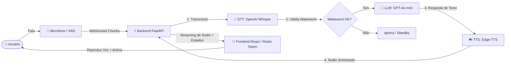

# 🎙️ Assistente de Voz Interativo com IA (Totem & Web)

Sistema completo de assistente de voz conversacional em tempo real com inteligência artificial, projetado tanto para uso em modo Totem/Tablet (com interface visual reativa) quanto para experimentos e ferramentas de transcrição de áudio.

---

## 🏗️ Visão Geral da Arquitetura

O projeto evoluiu de protótipos experimentais para uma solução cliente-servidor robusta e de baixa latência:



---

## 📂 Estrutura do Repositório

```text
conversa/
├── backend/                  # Servidor Principal (FastAPI + WebSockets)
│   ├── main.py               # Roteamento WebSocket, controle de fluxo e wakeword
│   └── providers/            # Provedores modulares de IA e áudio
│       ├── llm_openai.py     # Integração com OpenAI GPT (LLM)
│       ├── stt_openai.py     # Transcrição com Whisper (Speech-to-Text)
│       └── tts_edge.py       # Síntese de voz neural natural (Edge-TTS)
│
├── frontend/                 # Interface Web / Totem (React + TypeScript + Vite)
│   ├── src/
│   │   ├── App.tsx           # Captura de microfone (VAD), WebSockets e áudio
│   │   ├── AssistantFace.tsx # Rosto animado interativo (olhos e boca dinâmicos)
│   │   └── index.css         # Estilos e animações com Tailwind CSS
│   ├── package.json
│   └── vite.config.ts
│
├── prototipo/                # Histórico de Protótipos Experimentais (Streamlit)
│   ├── main.py               # V1: Assistente básico com TTS local (pyttsx3)
│   ├── main2.py              # V2: Assistente com TTS Google (gTTS)
│   ├── main3.py              # V3: Interface com balões de conversa aprimorados
│   ├── main4.py              # V4: Escuta contínua hands-free com threads
│   └── main5.py              # V5: Transcritor Whisper com exportação (.docx, .pdf, .txt, .md)
│
├── .env.example              # Modelo de variáveis de ambiente
├── pyproject.toml            # Dependências Python (uv / pip)
└── README.md                 # Documentação do projeto
```

---

## ✨ Funcionalidades Principais

### 1. 🖥️ Aplicação Principal (Totem Interativo)
- **Rosto Reativo (Avatar Animado):** Olhos e boca reagem dinamicamente aos estados do assistente (`idle`, `listening`, `thinking`, `speaking`).
- **Detecção de Silêncio / VAD (Voice Activity Detection):** Captura o áudio do usuário automaticamente quando ele começa a falar e envia o bloco assim que o silêncio é detectado.
- **Filtro de Palavra de Ativação (Wakeword):** Normalização de texto sem acentos e regex flexível (ex: *"Valéria"*, *"Oi Valéria"*, *"Ok Valéria"*, etc.) para evitar acionamentos acidentais durante conversas normais.
- **Áudio de Alta Qualidade:** Síntese neural natural em português (`pt-BR-FranciscaNeural` / `pt-BR-AntonioNeural`) via Edge-TTS.
- **Comunicação Bidirecional por WebSocket:** Latência reduzida para fluxo de áudio e atualização de estados visuais em tempo real.

### 2. 🧪 Protótipos Experimentais (`prototipo/`)
Para fins de teste, estudo ou execução de ferramentas isoladas com Streamlit:
- **`prototipo/main.py`:** Assistente de voz offline usando `pyttsx3` e `speech_recognition`.
- **`prototipo/main2.py`:** Assistente com `gTTS` (Google TTS) e integração OpenAI.
- **`prototipo/main3.py`:** Interface gráfica estilizada para histórico de chat.
- **`prototipo/main4.py`:** Loop de escuta contínua multithreaded (hands-free).
- **`prototipo/main5.py`:** Transcritor de arquivos de áudio/vídeo completos usando Whisper local, com exportação para `.txt`, `.docx`, `.pdf` e `.md`.

---

## 🚀 Como Executar

### Pré-requisitos
- **Python 3.10+** instalado
- **Node.js 18+** e **npm** instalados
- Gerenciador de pacotes Python: [`uv`](https://github.com/astral-sh/uv) (recomendado) ou `pip`

---

### 1. Configurar Variáveis de Ambiente

Crie um arquivo `.env` na raiz do projeto baseado no `.env.example`:

```bash
cp .env.example .env
```

Edite o `.env` e insira sua chave da OpenAI:

```env
ASSISTANT_NAME=Valéria
LLM_PROVIDER=openai
TTS_PROVIDER=edge-tts
STT_PROVIDER=openai
OPENAI_API_KEY=sua_chave_openai_aqui
```

---

### 2. Executar o Backend (FastAPI)

Na raiz do projeto:

```bash
# Usando uv (rápido):
uv run uvicorn backend.main:app --reload --host 0.0.0.0 --port 8000

# Ou usando ambiente virtual padrão:
python -m venv .venv
source .venv/bin/activate  # No Windows: .venv\Scripts\activate
pip install -e .
uvicorn backend.main:app --reload --host 0.0.0.0 --port 8000
```

O backend estará ativo em `http://localhost:8000` (e o WebSocket em `ws://localhost:8000/ws/audio`).

---

### 3. Executar o Frontend (React + Vite)

Em outro terminal, acesse a pasta `frontend`:

```bash
cd frontend
npm install
npm run dev
```

Acesse a interface no navegador pelo link exibido (geralmente `http://localhost:5173`).

---

### 4. Executar os Protótipos Streamlit (Opcional)

Caso queira executar qualquer uma das versões de protótipo:

```bash
# Exemplo executando o transcritor de áudio (main5):
streamlit run prototipo/main5.py
```

---

## 🛡️ Segurança e Boas Práticas

- Arquivos com credenciais (`.env`) e pastas de dependências (`.venv`, `node_modules`, `dist`) estão devidamente protegidos e incluídos no `.gitignore`.
- Nunca envie sua chave de API para o GitHub. Use sempre o `.env.example` para compartilhar a estrutura das variáveis.

---

## 📄 Licença

Este projeto é disponibilizado para fins educacionais e de desenvolvimento livre.
